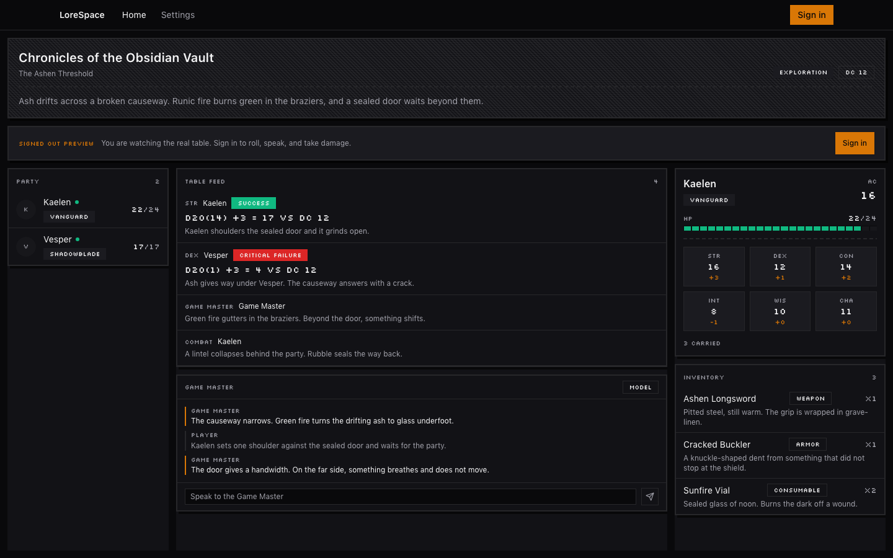

# LoreSpace

A real-time, multiplayer d20 tabletop where a party and an AI Game Master share
one live campaign — one table, one dice log, one source of truth.

**Live:** `https://lorespace.app.space` — deployed at Deploy #1 (`P3.8`, end of
day 2). Not live yet; this line is replaced the moment it is.



*Signed out, `/home` is the real table — the same campaign rows a signed-in
player sees ([ADR 0014](docs/adr/0014-public-read-table.md)). Sign in to roll.*

## What it is

LoreSpace is a shared virtual tabletop: players forge a d20 character, declare
actions, and roll against a scene DC while everyone's browser stays in sync over
a Durable Object record room. An AI Game Master narrates, sets the stakes, and
mutates persistent state through server-side tools — but it never invents a die
roll. Dice are computed on the server ([ADR 0005](docs/adr/0005-dice-roll-authority.md)),
outcomes are owned by the engine ([ADR 0009](docs/adr/0009-engine-owns-outcomes.md)),
and the whole table is readable by link, signed in or out.

## Run it locally

```sh
npm install
npx deepspace dev start     # vite + miniflare on http://localhost:5173
```

Sign-in uses the DeepSpace platform account (`npx deepspace auth login`). The
app's own data model is created automatically at first boot — there is no
migration step.

## Verify

```sh
npm run type-check          # tsc --noEmit
npm run lint                # eslint
npm run test:unit           # Vitest, node env
npm run validate            # type-check + unit
npm run build               # vite build + prerendered landing page
npx deepspace test run smoke
```

Multi-user specs need two test accounts (`npx deepspace test accounts recover
--all`), then `npx deepspace test run tests/collab.spec.ts`.

## Where things are

| Path | What |
| --- | --- |
| `src/pages/index.tsx` | static, prerendered landing page |
| `src/pages/(app)/home.tsx` | the three-column campaign table |
| `src/components/` | panels (`CharacterSheetPanel`, `InventoryPanel`, `vtt/*`) |
| `src/schemas/` | the four domain collections + RBAC |
| `src/actions/` | privileged server actions |
| `src/lib/preview-data.ts` | signed-out fixture, schema-exact |
| `docs/adr/` | the decisions behind the shape (start with 0005, 0009, 0014) |
| `docs/tasks.md` | the phase board and what is done |

## Status

Day 1 of the 96-hour build ([ADR 0008](docs/adr/0008-playable-interview-build.md)).
Shipped: the obsidian pixel theme, the landing page, and the full workspace
shell — scene banner, roster, dice feed, GM console, sheet, inventory. Next:
campaign seeding and GM actions (Phase 2), the live character sheet (Phase 3),
server-computed rolls and presence (Phase 4).
