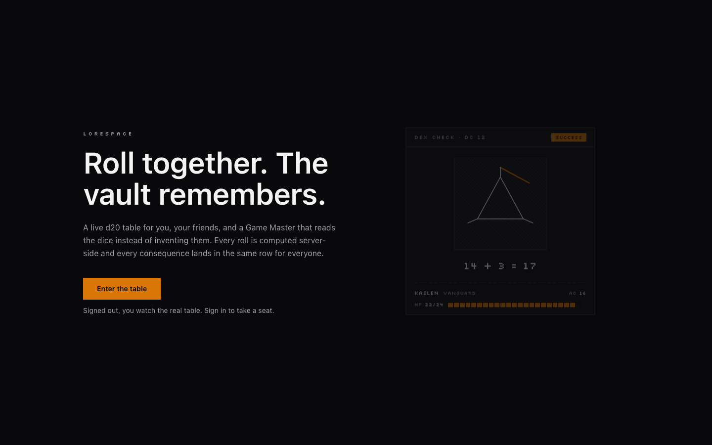
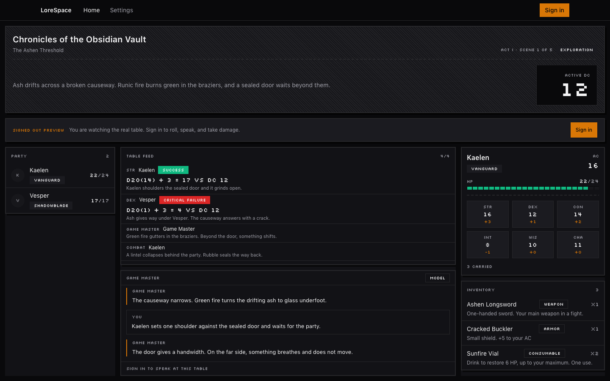
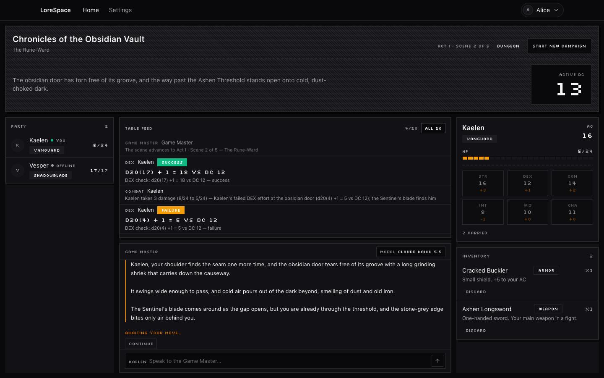

# LoreSpace

A real-time, multiplayer d20 tabletop where a party and an AI Game Master share
one live campaign — one table, one dice log, one source of truth.

**Live:** <https://lorespace.app.space>



## What it is

LoreSpace is a shared virtual tabletop: players forge a d20 character, declare
actions, and roll against the scene's stakes while every browser stays in sync
over a Durable Object record room. An AI Game Master narrates, sets a DC, and
mutates persistent state through server-side tools — but it never invents a die
roll. Dice are computed on the server, outcomes are owned by the engine, and the
table is readable by link, signed in or out.

## The table

Signed out, `/home` is the whole table: the live campaign's scene, party roster,
dice feed, GM console and the first character's sheet. It is the same campaign
rows a signed-in player sees, with a sign-in banner in place of the composer.



Signed in, a player forges one adventurer (six attributes, AC, HP, a pack) and
takes a seat. When the GM asks for a check, that ability lights up on the sheet;
rolling it writes a `roll-logs` row that every window renders — the roller from
the action's response, peers from the records socket, and the banner from the
newest log row. Presence carries identity only, never roll data.



## How the sync works

- **Records** live in a campaign-scoped Durable Object `RecordRoom`. A write
  (a forge, a roll, an HP change) broadcasts the changed row to every subscribed
  browser, so windows converge without polling or reloads.
- **Presence** is a second, membership-gated room. It carries who is at the
  table, their character identity and a typing flag — nothing that can disagree
  with the database.
- **The GM** runs one streamed turn per beat. Its write tools only run inside
  the in-app chat turn, and every consequence is a record write (`combat` or
  `gm_event` in `roll-logs`), so the prose can never claim a number the engine
  did not store.
- **The table is public-read by link**: visitors can read the campaign; writes
  stay member-only.

The app's data model is nine collections: `campaigns`, `characters`,
`inventory`, `roll-logs`, `gm-messages`, `settings`, `users`, plus the AI chat
pair `ai-chats` / `ai-messages`.

## Run it locally

```sh
npm install
npx deepspace dev start     # vite + miniflare on http://localhost:5173
```

Local sign-in note: use Chrome. Safari refuses the `__Secure-` session cookie on
`http://localhost`; it works on the deployed HTTPS URL. Sign-in uses the
DeepSpace platform account (`npx deepspace auth login`). The schema and default
campaign are created automatically at first boot — there is no migration step.

## Verify

```sh
npm run type-check          # tsc --noEmit, including tests/
npm run lint                # eslint
npm run test:unit           # Vitest
npm run test:e2e            # smoke + api + collab + presence (Playwright)
```

`npm test` runs the smoke and api suites only; `npm run test:e2e` adds the
multi-window specs. They require two cached DeepSpace test accounts
(`npx deepspace test accounts recover --all`) and a CLI login for the owner-only
check request.

## Where things are

| Path | What |
| --- | --- |
| `src/pages/index.tsx` | static, prerendered landing page |
| `src/pages/(app)/home.tsx` | the three-column campaign table |
| `src/components/` | panels (`CharacterSheetPanel`, `InventoryPanel`, `vtt/*`) |
| `src/schemas/` | the nine collections + RBAC |
| `src/actions/` | privileged server actions (forge, roll, GM mutation, reset) |
| `src/server/realtime-routes.ts` | record and presence room gates |
| `src/ai/` | GM tools, system brief, streamed chat route |
| `src/lib/preview-data.ts` | signed-out fixture, used only when the table is empty |

## Status

LoreSpace is live and playable at <https://lorespace.app.space>: pixel shell,
server-authored characters, presence and server-computed rolls, a streamed AI GM
with engine-gated scenes and narrative combat, and a deployed build covered by a
multi-window Playwright suite.
